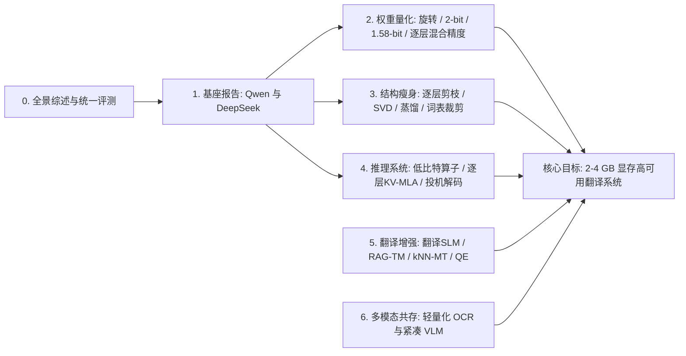

# 前沿大语言模型轻量化与低显存翻译系统：文献精读清单（Qwen / DeepSeek 路线）

> **研究锚点**：以 **Qwen**（如 Qwen2.5 / Qwen3 / Qwen-VL）或 **DeepSeek**（如 DeepSeek-V2/V3/R1 架构思想、R1-Distill-Qwen、DeepSeek-OCR）为核心研究对象；面向 **RTX 3060 8GB（Ampere SM86）**，将 LLM 总显存预算严控在 **2~4 GB**（预留显存与算力给 **OCR / 视觉模块**），借助 **前沿模型压缩 + 推理系统优化 + RAG/外部记忆补偿** 达成高质量可用翻译。

---

## 一、技术全景与阅读依赖图

下面这张图展示了本次收录的 7 个文献模块如何共同服务于 **“2~4 GB 显存实现高可用翻译 + OCR 共存”** 这一核心研究目标：



---

## 二、建议阅读节奏与优先级说明

面对 **77 条条目（含配套延伸共 85 篇核验文献）**，**切忌从头到尾逐字精读**。建议按优先级标记分三阶段推进：

* 🔴 **核心精读（33 条）**：决定你的技术认知底座与核心实验设计，建议精读方法、实验消融与公式推导（可先挑每个模块里最紧贴当前实验的 2~3 篇切入）。
* 🟡 **重点泛读（35 条）**：读摘要、引言、核心架构图与主要结果表，建立各方法之间的优劣边界。
* 🟢 **按需深挖（9 条）**：当你确定具体子课题（例如决定动手改词表、写 LUT/CPU 算子或做免数据谱分析）时再回头细读。

> [!TIP]
> **四周快速入门路线建议**
> - **第 1 周（建框架 + 摸透基座）**：读模块 0（1~2 篇综述）+ 模块 1（Qwen3、DeepSeek-V2/V3/R1、TransMLA）。搞清楚 Qwen 与 DeepSeek 的结构差异（尤其是 GQA vs MLA、152K 大词表代价、蒸馏机制）。
> - **第 2 周（攻克量化与逐层分配核心）**：读模块 2 中所有 🔴 论文（SmoothQuant/AWQ → SpinQuant → QTIP → ParetoQ → EvoPress / BitStack / 剪枝量化顺序）。搞清楚“离群值”“旋转平滑”“2-bit vs 4-bit 缩放律”“逐层非均匀比特分配”四大核心概念。
> - **第 3 周（逐层剪枝 + 结构瘦身 + 系统瓶颈）**：读模块 3（SLEB、Minitron、SVD-LLM V2、AdaptiVocab）+ 模块 4（Marlin、KIVI、PyramidKV、SGLang、EAGLE-3）。把视野从“算法压缩率”拉到“3060 真实显存与吞吐”。
> - **第 4 周（翻译补偿 + OCR 协同）**：读模块 5（ALMA/Seed-X/TranslateGemma + kNN-MT/RAGtrans/术语集成 + xCOMET/MetricX-24）+ 模块 6（DeepSeek-OCR、PaddleOCR-VL、Qwen3-VL）。形成自己的独立实验立项方案。

---

## 三、分模块文献清单（共 77 条 / 85 篇文献）

### 模块 0：全景综述与跨范式统一评测（先建立上帝视角）

| 优先级 | 论文与链接 | 年份 / 会议 | 核心贡献 | 对本研究的重点阅读价值 |
| :---: | :--- | :--- | :--- | :--- |
| 🔴 | [A Survey on Model Compression for Large Language Models](https://arxiv.org/abs/2308.07633) | 2024 / TACL | 最具代表性的 LLM 压缩全景综述，系统归类量化、剪枝、知识蒸馏与低秩分解及评测体系 | 作为入门地图，快速建立完整术语表与分类框架 |
| 🟡 | [Model Compression and Efficient Inference for Large Language Models: A Survey](https://arxiv.org/abs/2402.09669) | 2024 / arXiv | 从算法视角梳理压缩与推理加速，区分“免微调（Tuning-Free）”与“需恢复微调”方法 | 帮你评估哪些方法在低训练算力下可复现 |
| 🟡 | [Optimizing LLMs for Resource-Constrained Environments: A Survey of Model Compression Techniques](https://arxiv.org/abs/2505.02309) | 2025 / arXiv | 聚焦资源受限环境的 2025 新综述，整合量化、剪枝与蒸馏最新进展 | 补齐 2024 下半年到 2025 上半年的新路线 |
| 🔴 | [UniComp: A Unified Evaluation of Large Language Model Compression via Pruning, Quantization, and Distillation](https://arxiv.org/abs/2602.09130) | 2026 / EMNLP | 在统一口径下横向比较剪枝、量化、蒸馏在性能、可靠性与效率上的真实得失 | **高度契合本研究**：学习如何设计严谨的跨范式消融评测实验 |

---

### 模块 1：基础模型架构报告（Qwen × DeepSeek 双主线）

> [!IMPORTANT]
> 选 **Qwen** 与 **DeepSeek** 作为底座有一个极大研究优势：两者在开源生态中形成天然互补——**Qwen** 提供最强的 0.6B–8B 稠密小模型与中/英/日多语种底座，**DeepSeek** 贡献了最具颠覆性的架构与蒸馏范式（MLA 低秩 KV Cache、MTP 多 Token 预测、R1→Qwen 蒸馏、DeepSeek-OCR 光学压缩），并且已有前沿论文直接把 DeepSeek 的 MLA 移植到了 Qwen 上。

| 优先级 | 论文与链接 | 年份 | 核心贡献 | 对本研究的重点阅读价值 |
| :---: | :--- | :--- | :--- | :--- |
| 🟡 | [Qwen2.5 Technical Report](https://arxiv.org/abs/2412.15115) | 2024.12 | 详述 Qwen2.5 0.5B–72B 的预训练数据、152K 词表与多语种能力 | 理解 Qwen 系列基础架构、GQA 配置与大词表显存特征 |
| 🔴 | [Qwen3 Technical Report](https://arxiv.org/abs/2505.09388) | 2025.05 | 推出 0.6B–32B 稠密与 MoE 系列，首创单模型内“思考/非思考”双模式切换与强多语覆盖 | **主力实验底座候选（Qwen3-4B / Qwen3-8B）**：重点看小尺寸模型与多语种评测、思考模式在翻译中的取舍 |
| 🔴 | [DeepSeek-V2: A Strong, Economical, and Efficient Mixture-of-Experts Language Model](https://arxiv.org/abs/2405.04434) | 2024.05 | 提出 **MLA（Multi-head Latent Attention）** 将 KV Cache 压缩数倍至十几倍，以及细粒度 DeepSeekMoE | **必读架构创新**：彻底搞懂 MLA 如何用低秩联合投影打破长上下文显存瓶颈 |
| 🟡 | [DeepSeek-V3 Technical Report](https://arxiv.org/abs/2412.19437) | 2024.12 | 在 MLA 基础上引入 **MTP（多 Token 预测）** 与细粒度分块 FP8 量化训练策略 | 关注 MTP 如何用于低成本投机解码，以及分块缩放对量化精度的启示 |
| 🔴 | [DeepSeek-R1: Incentivizing Reasoning Capability in LLMs via Reinforcement Learning](https://arxiv.org/abs/2501.12948) | 2025.01 | 展示纯 RL 激发推理及**将强推理模型蒸馏到 Qwen-1.5B/7B/14B** 的惊人效果 | **核心启发**：证明对小模型而言，高质量教师蒸馏往往远比在小模型上直接跑 RL 更省算力且更有效 |
| 🔴 | [TransMLA: Multi-head Latent Attention Is All You Need](https://arxiv.org/abs/2502.07864) | 2025.02 | 将现有 GQA 模型（如 Qwen2.5 / Llama）低成本转换为 DeepSeek 风格的 MLA 架构 | **Qwen × DeepSeek 黄金交叉点**：让你能在 Qwen 小模型上实验 DeepSeek MLA 的极致 KV 压缩 |
| 🟡 | [Towards Economical Inference: Enabling DeepSeek's Multi-Head Latent Attention in Any Transformer-based LLMs (MHA2MLA)](https://arxiv.org/abs/2502.14837) | 2025.02 | 系统化把标准 MHA/GQA 转换为 MLA（后续扩展至多模态 [MHA2MLA-VLM](https://arxiv.org/abs/2601.11464)） | 与 TransMLA 对照阅读，探索文本+视觉模型的统一 KV 压缩 |

---

### 模块 2：权重量化——从经典 PTQ 到旋转消离群值、极限 2-bit 与 1.58-bit

这是将 4B–8B 模型压缩进 **1.5~3.2 GB 权重空间** 的核心技术栈。

#### 2.1 经典奠基（理解“离群值”与误差补偿原理）

| 优先级 | 论文与链接 | 年份 / 会议 | 核心贡献 | 对本研究的重点阅读价值 |
| :---: | :--- | :--- | :--- | :--- |
| 🟡 | [GPTQ: Accurate Post-Training Quantization for Generative Pre-trained Transformers](https://arxiv.org/abs/2210.17323) | 2023 / ICLR | 基于二阶 Hessian 信息的逐层权重量化误差补偿，开启 LLM 4-bit PTQ 时代 | 理解 Hessian 权重重要性与校准集误差补偿的数学直觉 |
| 🔴 | [SmoothQuant: Accurate and Efficient Post-Training Quantization for Large Language Models](https://arxiv.org/abs/2211.10438) | 2023 / ICML | 揭示激活离群值（Activation Outliers）规律，用数学等价缩放把量化难度从激活转移给权重 | 必读基础：不理解离群值就看不懂后续 SpinQuant / QuaRot / FlatQuant |
| 🔴 | [AWQ: Activation-aware Weight Quantization for LLM Compression and Acceleration](https://arxiv.org/abs/2306.00978) | 2024 / MLSys | 发现仅需保护激活幅值最高的约 1% 显著权重通道即可大幅保真，且避免过拟合校准集 | 实用性极强的 W4A16 基准方法，重点看“领域校准集”与泛化性的权衡 |
| 🔴 | [QLoRA: Efficient Finetuning of Quantized LLMs](https://arxiv.org/abs/2305.14314) | 2023 / NeurIPS | 提出 NF4 数据类型、双重量化与分页优化器，实现单卡低显存微调量化模型 | 让你在 RTX 3060 8GB 或单张免费/低价云卡上就能做翻译任务微调与量化恢复 |

#### 2.2 前沿一：正交旋转与分布压平（攻克 4-bit 甚至 W4A4 / KV4 退化）

| 优先级 | 论文与链接 | 年份 / 会议 | 核心贡献 | 对本研究的重点阅读价值 |
| :---: | :--- | :--- | :--- | :--- |
| 🟡 | [QuaRot: Outlier-Free 4-Bit Inference in Rotated LLMs](https://arxiv.org/abs/2404.00456) | 2024 / NeurIPS | 利用计算不变性插入随机 Hadamard 旋转矩阵，端到端消除权重、激活与 KV Cache 离群值 | 理解“计算不变性（Computational Invariance）”如何几乎零推理开销地消除离群值 |
| 🔴 | [SpinQuant: LLM Quantization with Learned Rotations](https://arxiv.org/abs/2405.16406) | 2025 / ICLR | 在 QuaRot 基础上通过 Cayley 优化**学习最优正交旋转矩阵**，大幅缩小低比特与 FP16 差距 | **当前低比特量化核心前沿**：特别关注它在难量化小模型上的 4-bit 权重+KV 协同表现 |
| 🟡 | [FlatQuant: Flatness Matters for LLM Quantization](https://arxiv.org/abs/2410.09426) | 2024.10 | 用快速可学习的逐层仿射变换（Kronecker 分解）替代纯正交旋转，进一步压平分布 | 与 SpinQuant 对比：探索更强表达力的变换对翻译任务精度的增益 |

#### 2.3 前沿二：2~3-bit 极限非均匀 / 格点 / 网格量化（挑战“8B 塞进 3 GB”）

| 优先级 | 论文与链接 | 年份 / 会议 | 核心贡献 | 对本研究的重点阅读价值 |
| :---: | :--- | :--- | :--- | :--- |
| 🟡 | [AQLM: Extreme Compression of Large Language Models via Additive Quantization](https://arxiv.org/abs/2401.06118) | 2024 / ICML | 将多码本加法量化引入 LLM，实现 2-bit 级别可用精度 | 了解矢量量化（VQ）为何能在 2-bit 突破标量量化的信息论极限 |
| 🟡 | [QuIP#: Even Better LLM Quantization with Hadamard Incoherence and Lattice Codebooks](https://arxiv.org/abs/2402.04396) | 2024 / ICML | 随机 Hadamard 非相干处理 + $E_8$ 格点码本向量量化，实现极强 2-bit 精度 | 理解 $E_8$ 格点球形打包原理（另可参考前作 [QuIP](https://arxiv.org/abs/2307.13304)） |
| 🔴 | [QTIP: Quantization with Trellises and Incoherence Processing](https://arxiv.org/abs/2406.11235) | 2024 / NeurIPS | 用**网格编码量化（TCQ）**替代查表码本，线性扩展至超高维同时保留 GPU 友好解码速度 | **2~3-bit 必读代表作**：非常适合作为“Qwen3-8B @ 2.5-bit vs Qwen3-4B @ 4-bit”实验组 |

#### 2.4 前沿三：原生 1.58-bit / 1-bit 与极低比特缩放律

| 优先级 | 论文与链接 | 年份 / 会议 | 核心贡献 | 对本研究的重点阅读价值 |
| :---: | :--- | :--- | :--- | :--- |
| 🟡 | [The Era of 1-bit LLMs: All Large Language Models are in 1.58 Bits](https://arxiv.org/abs/2402.17764) | 2024.02 | 提出三值权重 $\{-1, 0, 1\}$ 的 BitNet b1.58，消除浮点乘法、大幅降低内存与能耗 | 了解原生低比特架构为何与后训练量化（PTQ）走上完全不同的路线（另见 [BitNet b1.58 Reloaded](https://arxiv.org/abs/2407.09527)） |
| 🟡 | [BitNet b1.58 2B4T Technical Report](https://arxiv.org/abs/2504.12285) | 2025.04 | 首个开源原生 1.58-bit 2B 规模模型（4T tokens 训练），权重仅 ~0.4 GB | 作为超低显存对照组：测试 0.5 GB 模型配合强 RAG 能把翻译拉升到什么程度 |
| 🔴 | [ParetoQ: Scaling Laws in Extremely Low-bit LLM Quantization](https://arxiv.org/abs/2502.02631) | 2025.02 | 统一评估 1 / 1.58 / 2 / 3 / 4-bit 的缩放律，揭示 2-bit 与 3-bit 之间存在显著表征相变 | **研究立项必读**：直接为“固定 2~4 GB 预算下如何权衡参数量与比特数”提供理论依据 |
| 🟢 | [QuEST: Stable Training of LLMs with 1-Bit Weights and Activations](https://arxiv.org/abs/2502.05003) | 2025 / NeurIPS | 提出 Hadamard 归一化与信赖域梯度估计，实现稳定的 1-bit 权重+激活（W1A1）训练 | 了解极低比特 QAT 训练稳定性的前沿解法 |

#### 2.5 前沿四：逐层混合精度量化、动态显存伸缩与剪枝-量化联合

Transformer 首尾层与 `attn_v`/`ffn_down` 极度敏感，而中间层高度冗余。按层敏感度**非均匀分配比特（甚至联合删层/剪枝）**，在严格 2~4 GB 预算下往往全面优于全模型一刀切量化。

| 优先级 | 论文与链接 | 年份 / 会议 | 核心贡献 | 对本研究的重点阅读价值 |
| :---: | :--- | :--- | :--- | :--- |
| 🔴 | [EvoPress: Accurate Dynamic Model Compression via Evolutionary Search](https://arxiv.org/abs/2410.14649) | 2025 / ICML | 用进化搜索在极短时间内搜出最优逐层非均匀压缩配比，**统一涵盖逐层混合精度量化、逐层删层（Layer Drop）与逐层稀疏** | **逐层压缩核心必读**：可直接改用双语翻译校准集搜索 Qwen3 在 2.5 / 3.0 GB 下的最优逐层配比 |
| 🟡 | [Layer-Wise Quantization: A Pragmatic and Effective Method for Quantizing LLMs Beyond Integer Bit-Levels](https://arxiv.org/abs/2406.17415) | 2024.06 | 基于层敏感度（Embedding 漂移等）逐层分配不同整数位宽，实现任意非整数平均位宽（如 2.75-bit） | 思路直观、易复现，适合做逐层混合精度基线 |
| 🟡 | [SliM-LLM: Salience-Driven Mixed-Precision Quantization for Large Language Models](https://arxiv.org/abs/2405.14917) | 2024.05 | 提出显著度驱动的混合精度量化框架，在 2~3-bit 极端压缩区间大幅保留模型精度 | 与 EvoPress 对照，研究细粒度显著度指标对翻译精度的影响 |
| 🔴 | [BitStack: Any-Size Compression of Large Language Models in Variable Memory Environments](https://arxiv.org/abs/2410.23918) | 2024.10 | 通过残差 SVD 将权重分解为可叠加“比特栈”，**单份权重可在推理时按剩余显存动态增减每层精度** | **极度契合 OCR 共存场景**：OCR 高负载时把 LLM 临时压到 ~2.2 GB，空闲时瞬间恢复到 ~3.8 GB，免重新加载模型 |
| 🔴 | [Prune-then-Quantize or Quantize-then-Prune? Understanding the Impact of Compression Order in Joint Model Compression](https://arxiv.org/abs/2603.18426) | 2026.03 | 系统剖析联合压缩中**先剪枝再量化**与**先量化再剪枝**的耦合误差传播规律 | 打算同时做“逐层剪枝 + 低比特量化”前必读，避免踩联合压缩顺序坑 |

> [!NOTE]
> **工程实践补充阅读**：除上述学术论文外，工程落地阶段建议一并阅读 **Unsloth Dynamic 2.0 GGUF**（按层敏感度与 KL 散度动态混合量化）与 **`llama.cpp` `imatrix` / K-Quants / I-Quants** 的技术说明——它们常在消费级显卡上作为极强工程基线与学术方法对照。

---

### 模块 3：逐层剪枝、结构化瘦身、低秩分解、知识蒸馏与词表裁剪

量化压缩“每个参数的比特数”，本模块压缩“层数与参数量本身”——尤其对 **中深层冗余裁剪**、**Qwen 的 152K 大词表** 和 **小模型专项能力迁移** 效果惊人。

#### 3.1 逐层深度剪枝与非均匀层稀疏度

| 优先级 | 论文与链接 | 年份 / 会议 | 核心贡献 | 对本研究的重点阅读价值 |
| :---: | :--- | :--- | :--- | :--- |
| 🟡 | [ShortGPT: Layers in Large Language Models are More Redundant Than You Expect](https://arxiv.org/abs/2403.03853) | 2024.03 | 定义 **BI（Block Influence）** 余弦相似度冗余指标，直接按层重要性删除最冗余的整层 Transformer | 最轻便的整层删除基线：删层后仍是标准稠密架构，3060 显存、KV 与延迟同步线性下降 |
| 🟡 | [The Unreasonable Ineffectiveness of the Deeper Layers](https://arxiv.org/abs/2403.17887) | 2024.03 | 用层间角距离系统揭示深层成片冗余现象，删去大段深层后用极轻量 QLoRA 即可快速恢复 | 单卡可复现，适合研究“翻译任务下哪些深层可安全裁剪” |
| 🔴 | [SLEB: Streamlining LLMs through Redundancy Verification and Elimination of Transformer Blocks](https://arxiv.org/abs/2402.09025) | 2024 / ICML | 指出删掉一层后剩余层的重要性会动态变化，提出**迭代式逐层冗余验证与消除**，避免一次性删多层崩坏 | **整层剪枝必读**：比 ShortGPT 更稳健，非常适合对连贯性敏感的机器翻译 |
| 🟡 | [Shortened LLaMA: Depth Pruning for Large Language Models with Comparison of Retraining Methods](https://arxiv.org/abs/2402.02834) | 2024.02 | 系统比较不同深度（整层）剪枝指标与后续 LoRA / 全参恢复微调策略的性价比 | 为“删层后如何低成本恢复翻译质量”提供方法论对照 |
| 🟡 | [LaCo: Large Language Model Pruning via Layer Collapse](https://arxiv.org/abs/2402.11187) | 2024.02 | 不直接丢弃冗余层，而是将相邻多层权重差分**折叠合并（Layer Collapse）**至前一层，免重训保留更多知识 | 对保住多语种词汇和跨语种映射知识比硬删更温和 |
| 🟢 | [Outlier Weighed Layerwise Sparsity (OWL): A Missing Secret Sauce for Pruning LLMs to High Sparsity](https://arxiv.org/abs/2310.05175) | 2024 / ICML | 按每层激活离群值比例非均匀分配剪枝率（离群值多的层少剪、少的层狠剪），高稀疏下显著保真 | 揭示层离群值与抗剪能力的强相关性（注意非结构化稀疏在 3060 上难换实速，更宜迁移为结构化剪枝率指导） |
| 🟢 | [AlphaPruning: Using Heavy-Tailed Self Regularization Theory for Improved Layer-wise Pruning of Large Language Models](https://arxiv.org/abs/2410.10912) | 2024 / NeurIPS | 基于重尾自正则化理论（HTSR / 权重矩阵特征谱幂律指数 $\alpha$）**免校准数据**计算逐层最优剪枝率 | 极优雅的理论工具，可用于免数据快速初筛 Qwen 各层敏感度 |

#### 3.2 通用结构化剪枝、低秩分解、知识蒸馏与词表裁剪

| 优先级 | 论文与链接 | 年份 / 会议 | 核心贡献 | 对本研究的重点阅读价值 |
| :---: | :--- | :--- | :--- | :--- |
| 🟡 | [A Simple and Effective Pruning Approach for Large Language Models (Wanda)](https://arxiv.org/abs/2306.11695) | 2024 / ICLR | 按“权重幅值 × 激活范数”免重训剪枝，支持非结构化与 2:4 半结构化稀疏 | 重点理解：**非结构化剪枝为何难以在 3060 上带来显存与速度红利**，以及 Ampere 2:4 稀疏的现实局限 |
| 🟢 | [Sheared LLaMA: Accelerating Language Model Pre-training via Structured Pruning](https://arxiv.org/abs/2310.06694) | 2024 / ICLR | 端到端学习掩码实现结构化剪枝，配合动态批量加载恢复能力 | 结构化剪枝经典基线 |
| 🔴 | [Compact Language Models via Pruning and Knowledge Distillation (Minitron)](https://arxiv.org/abs/2407.14679) | 2024 / NeurIPS | NVIDIA 提出沿宽度与深度做激活重要性结构化剪枝 + 极少 token 蒸馏恢复（配套实践指南 [arXiv:2408.11796](https://arxiv.org/abs/2408.11796)） | **极其重要**：比从头训练小模型省 40× 算力，可直接指导“将 Qwen3-8B 结构化剪枝+蒸馏成 3B/4B 翻译专用小模型” |
| 🟡 | [ASVD: Activation-aware Singular Value Decomposition for Compressing Large Language Models](https://arxiv.org/abs/2312.05821) | 2023.12 | 结合激活分布平滑后再做奇异值分解，避免离群值破坏低秩近似 | 理解 SVD 与量化的正交性（可同时压缩权重与 KV Cache） |
| 🟡 | [SVD-LLM: Truncation-aware Singular Value Decomposition for Large Language Model Compression](https://arxiv.org/abs/2403.07378) | 2025 / ICLR | 建立奇异值截断与模型输出损失的直接映射（截断感知白化），大幅提升免训练低秩压缩精度 | 掌握 SVD-LLM 核心白化数学推导 |
| 🔴 | [SVD-LLM V2: Optimizing Singular Value Truncation for Large Language Model Compression](https://arxiv.org/abs/2503.12340) | 2025 / NAACL | 引入逐层异构压缩率分配与更稳健的数值分解，克服 Cholesky 不稳定性并加速压缩 | **前沿低秩分解必看**：探索“SVD 降维 + 4-bit 量化”双压缩组合拳 |
| 🟡 | [MiniLLM: Knowledge Distillation of Large Language Models](https://arxiv.org/abs/2306.08543) | 2024 / ICLR | 指出常规前向 KL 蒸馏会让小模型过度平滑，提出**反向 KL / On-Policy 蒸馏** | 如果你用大 Qwen / DeepSeek 教师向 1.5B–4B 学生蒸馏翻译能力，这是最关键的损失函数参考 |
| 🔴 | [AdaptiVocab: Enhancing LLM Efficiency in Focused Domains through Lightweight Vocabulary Adaptation](https://arxiv.org/abs/2503.19693) | 2025.03 | 针对特定领域/任务轻量裁剪与适配词表并重构 Embedding，大幅降低计算与显存占用 | **翻译场景超高 ROI 切入点**：Qwen 152K 词表中大量无关语种 token 可安全裁剪，在 3B–4B 模型上可立省 300–600 MB 显存 |
| 🟡 | [VocabTrim: Vocabulary Pruning for Efficient Speculative Decoding in Large Language Models](https://arxiv.org/abs/2506.22694) | 2025.06 | 免训练裁剪草稿模型 LM Head 词表（仅保留高频核心词），主模型全词表校验保证严格无损 | 解决大词表小模型 LM Head 显存带宽瓶颈的优雅方案 |
| 🟢 | [FR-Spec: Accelerating Large-Vocabulary Language Models via Frequency-Ranked Speculative Sampling](https://arxiv.org/abs/2502.14856) | 2025.02 | 按词频排序压缩大词表（专门针对 Qwen/Llama-3 级 128K–152K 词表）投机采样开销 | 与 VocabTrim 配套，直接对症 Qwen 152K 词表 |

---

### 模块 4：推理系统、Ampere 底层低比特算子、KV Cache 与投机解码

在 RTX 3060 8GB（240 GB/s 低显存带宽）上，**算法压缩率 ≠ 实测加速比**。这一模块让你彻底打通算法与硬件。

| 优先级 | 论文与链接 | 年份 / 会议 | 核心贡献 | 对本研究的重点阅读价值 |
| :---: | :--- | :--- | :--- | :--- |
| 🔴 | [MARLIN: Mixed-Precision Auto-Regressive Parallel Inference on Large Language Models](https://arxiv.org/abs/2408.11743) | 2024.08 | 通过权重预重排与 Ampere `cp.async` 异步流水线，让 W4A16 推理逼近理论显存带宽上限（约 4× 加速） | **RTX 3060 (Ampere) 必读内核论文**：理解为何同样 4-bit，不同算子速度差 2~3 倍 |
| 🟡 | [Ladder: Enabling Efficient Low-Precision Deep Learning Computing through Hardware-aware Tensor Transformation](https://www.usenix.org/conference/osdi24/presentation/zhai) | 2024 / OSDI | 提出硬件感知低比特张量变换编译器，支撑任意低比特（如 INT2/NF4/1.58-bit）高效映射 GPU Tensor Core（演进为微软开源 **BitBLAS**） | 探索 2-bit / 1.58-bit 在 3060 上如何不靠硬件原生指令也能高效运行 |
| 🟢 | [LUT-GEMM: Quantized Matrix Multiplication based on LUTs for Efficient Inference in Large-Scale Generative Language Models](https://arxiv.org/abs/2206.09557) | 2024 / ICLR | 用查表法（LUT）绕过非均匀/极低比特权重的昂贵反量化开销，直接执行矩阵乘 | 理解 2-bit/3-bit 非均匀量化在 GPU 上的加速原理 |
| 🟢 | [T-MAC: CPU Renaissance via Table Lookup for Low-Bit LLM Deployment on Edge](https://arxiv.org/abs/2407.00088) | 2025 / EuroSys | 用位级查表（`pshuf`/`tbl`）重构 CPU 端低比特推理，彻底消除乘法运算 | 若你的实验包含 CPU/GPU 混合卸载（例如把 1.58-bit 草稿或辅助模型放 CPU），必看 |
| 🟡 | [Efficient Memory Management for Large Language Model Serving with PagedAttention (vLLM)](https://arxiv.org/abs/2309.06180) | 2023 / SOSP | 借鉴操作系统虚拟内存分页管理 KV Cache，几乎消灭显存碎片 | 理解推理引擎显存占用的底层机理 |
| 🔴 | [SGLang: Efficient Execution of Structured Language Model Programs (RadixAttention)](https://arxiv.org/abs/2312.07104) | 2024 / NeurIPS | 提出 RadixAttention 前缀树自动复用 KV Cache，并原生支持结构化约束解码 | **翻译+RAG 系统利器**：固定翻译指令与共享术语前缀零重复 Prefill，同时支持结构化输出约束 |
| 🔴 | [KIVI: A Tuning-Free Asymmetric 2bit Quantization for KV Cache](https://arxiv.org/abs/2402.02750) | 2024 / ICML | 揭示 Key 通道离群值与 Value token 分布差异，实现免微调 **Key 按通道 / Value 按 token 的 2-bit KV 量化** | 极低显存下保住长上下文与 RAG 片段的关键论文 |
| 🟢 | [KVQuant: Towards 10 Million Context Length LLM Inference with KV Cache Quantization](https://arxiv.org/abs/2401.18079) | 2024 / NeurIPS | 提出 Pre-RoPE Key 量化、非均匀敏感度码本与稀疏离群值保留，推进极低比特 KV 压缩 | 与 KIVI 对照，深挖 RoPE 与 KV 量化的耦合细节 |
| 🟢 | [SnapKV: LLM Knows What You are Looking for Before Generation](https://arxiv.org/abs/2404.14469) | 2024 / NeurIPS | 利用观测窗口注意力聚合自动筛选重要历史 KV，免微调大幅压缩长提示词显存 | 适合长文档/多轮对话翻译时的动态 KV 裁剪 |
| 🔴 | [PyramidKV: Dynamic KV Cache Compression based on Pyramidal Information Funneling](https://arxiv.org/abs/2406.02069) | 2024.06 | 发现浅层注意力发散、深层高度聚合的“信息漏斗”规律，按**金字塔形逐层递减分配 KV Cache 预算** | **逐层 KV 压缩必读**：把有限 KV 显存优先给浅层，和逐层权重压缩形成完美呼应 |
| 🟡 | [More Tokens, Lower Precision: Towards the Optimal Token-Precision Trade-off in KV Cache Compression](https://arxiv.org/abs/2412.12706) | 2024.12 | 在固定 KV 显存下联合权衡逐层的“保留 token 数量 vs 量化比特精度” | 为长文档 RAG 翻译中的 KV 预算分配提供联合最优原则 |
| 🟡 | [Better & Faster Large Language Models via Multi-token Prediction (MTP)](https://arxiv.org/abs/2404.19737) | 2024 / ICML | 训练时并行预测未来多个 token，兼顾更强表征与原生自投机解码提速 | DeepSeek-V3 MTP 的理论源头 |
| 🔴 | [EAGLE-3: Scaling up Inference Acceleration of Large Language Models via Training-Time Test](https://arxiv.org/abs/2503.01840) | 2025.03 | 融合多层特征与训练期测试展开（TTT），以极轻量草稿头实现 3×~6× 无损解码加速 | **低带宽显卡提速前沿**：配合 VocabTrim，仅加极少显存即可让 3060 解码速度起飞 |

---

### 模块 5：翻译特化小模型、RAG / 术语 / 翻译记忆补偿与科学评测

这一模块回答你的第二个核心假设：**“不让 2~4 GB 小模型孤军奋战，如何通过专项训练配方 + 外部知识系统把翻译能力拉满，并科学衡量它？”**

#### 5.1 翻译特化小模型与对齐配方（可直接迁移至 Qwen / DeepSeek）

| 优先级 | 论文与链接 | 年份 / 会议 | 核心贡献 | 对本研究的重点阅读价值 |
| :---: | :--- | :--- | :--- | :--- |
| 🔴 | [A Paradigm Shift in Machine Translation: Boosting Translation Performance of Large Language Models (ALMA)](https://arxiv.org/abs/2309.11674) | 2024 / ICLR | 颠覆传统大平行语料训练：先用单语数据强化目标语，再用**极少量高质量平行语料微调**即可大幅提升翻译 | 极省算力的翻译微调配方，非常适合复现到 Qwen3-4B 上 |
| 🟡 | [Contrastive Preference Optimization: Pushing the Boundaries of LLM Performance in Machine Translation (ALMA-R)](https://arxiv.org/abs/2401.08417) | 2024 / ICML | 提出 CPO 偏好优化（对比优/劣译文，避免 SFT 模仿参考译文瑕疵），显著压低翻译腔 | 学习如何用少量偏好数据给轻量化模型“去翻译腔”与补齐量化损失 |
| 🟡 | [Tower: An Open Multilingual Large Language Model for Translation-Related Tasks](https://arxiv.org/abs/2402.17733) | 2024 / COLM | 统一翻译、术语约束、译后编辑（APE）与质量估计（QE）的开源多任务翻译 LLM | 重点参考其数据配比与多任务翻译能力设计 |
| 🔴 | [Seed-X: Building Strong Multilingual Translation LLM with 7B Parameters](https://arxiv.org/abs/2507.13618) | 2025.07 | 7B 专用多语种翻译模型，引入**翻译专用思维链（CoT）**提升复杂句与习语翻译上限 | 极佳对照：研究“7B 2.5-bit + 短 CoT”与“4B 4-bit 直译”的延迟/质量权衡 |
| 🟡 | [Hunyuan-MT Technical Report](https://arxiv.org/abs/2509.05209) | 2025.09 | 2025 轻量多语种翻译大模型技术报告，涵盖多阶段训练、蒸馏与轻量推理优化 | 了解工业界最新轻量翻译模型的数据工程与强化学习细节 |
| 🔴 | [TranslateGemma Technical Report](https://arxiv.org/abs/2601.09012) | 2026.01 | 4B/12B/27B 开源翻译标杆，采用 **MetricX-QE + AutoMQM 奖励集成强化学习**，且 **4B 原生保留图像内文字直接翻译能力** | **2026 必读标杆**：不仅提供 RL 配方参考，其 4B 多模态能力还是你评测“OCR+Qwen” vs “端到端 VLM”的黄金对照 |

#### 5.2 RAG、翻译记忆（TM）、术语表与 kNN-MT（外部能力补偿核心）

| 优先级 | 论文与链接 | 年份 / 会议 | 核心贡献 | 对本研究的重点阅读价值 |
| :---: | :--- | :--- | :--- | :--- |
| 🔴 | [Nearest Neighbor Machine Translation (kNN-MT)](https://arxiv.org/abs/2010.00710) | 2021 / ICLR | 检索外部翻译记忆库并在**解码概率分布层插值**，无需重训即可跨领域暴涨翻译精度（提速改进见 [arXiv:2312.07419](https://arxiv.org/abs/2312.07419)） | **超越 Prompt 注入的必读思想**：当低比特小模型忽略 Prompt 术语时，概率层干预是极强研究方向 |
| 🟡 | [Dictionary-based Phrase-level Prompting of Large Language Models for Machine Translation](https://arxiv.org/abs/2302.07856) | 2023.02 | 早期系统验证用双语词典短语提示 LLM 改善生僻词/领域词翻译的效果 | 词典增强翻译的简洁基线 |
| 🟡 | [Chain-of-Dictionary Prompting Elicits Translation in Large Language Models (CoD)](https://arxiv.org/abs/2305.06575) | 2023.05 | 提出多语词典链提示法，用外部双语词典桥接低资源与专有表达 | 适合研究如何用零显存本地词典帮 2B–4B 小模型补齐长尾词 |
| 🔴 | [Efficient Terminology Integration for LLM-based Translation in Specialized Domains](https://arxiv.org/abs/2410.15690) | 2024 / WMT | 结合 **Trie 树术语抽取**与结构化提示约束，在专利/金融/医学领域大幅提升 LLM 术语命中率 | **最贴近工程与研究结合**：Trie 在 CPU 上耗时 < 1ms、0 显存，极适合你的架构 |
| 🔴 | [RAGtrans: Retrieval-Augmented Machine Translation with Unstructured Knowledge](https://arxiv.org/abs/2412.04342) | 2024 / EMNLP Findings | 突破传统平行句对翻译记忆限制，构建利用**非结构化领域文档**做 RAG 辅助翻译的基准与方法 | 研究如何用百科/设定集/背景文档直接辅助小模型消除指代歧义与语境误翻 |

#### 5.3 翻译质量评测与无参考质量估计（QE）

| 优先级 | 论文与链接 | 年份 / 会议 | 核心贡献 | 对本研究的重点阅读价值 |
| :---: | :--- | :--- | :--- | :--- |
| 🔴 | [xCOMET: Transparent Machine Translation Evaluation through Fine-grained Error Detection](https://arxiv.org/abs/2310.10482) | 2024 / TACL | 不仅给出句级质量分，还能定位细粒度翻译错误片段（错译/漏译/术语错），远胜 BLEU | **你的评测核心指标**：能精确诊断“量化到 3-bit 后到底坏在了哪里” |
| 🟡 | [MetricX-24: The Google Submission to the WMT 2024 Metrics Shared Task](https://arxiv.org/abs/2410.03983) | 2024 / WMT | 顶级翻译评估模型，同时支持有参考与**无参考（QE）打分** | 无参考 QE 既可作离线评委，也可作在线**不确定性路由**（低分句触发重译/扩召回） |

---

### 模块 6：轻量化 OCR 与紧凑视觉语言模型（8 GB 显存共存与路线对比）

| 优先级 | 论文与链接 | 年份 | 核心贡献 | 对本研究的重点阅读价值 |
| :---: | :--- | :--- | :--- | :--- |
| 🔴 | [DeepSeek-OCR: Contexts Optical Compression](https://arxiv.org/abs/2510.18234) | 2025.10 | DeepSeek 提出**上下文光学压缩**范式（`DeepEncoder` + 轻量 MoE 解码器），将高密度文本图像压缩成极少视觉 token | **DeepSeek 主线必读**：既是前沿 OCR，也启发了“长上下文视觉压缩”的新研究视角 |
| 🟡 | [General OCR Theory: Towards OCR-2.0 via a Unified End-to-end Model (GOT-OCR2.0)](https://arxiv.org/abs/2409.01704) | 2024.09 | 统一端到端 OCR 2.0 范式，单模型处理纯文本、公式、表格与复杂版面 | 理解传统检测+识别管线向端到端轻量化 OCR 演进的转折点 |
| 🔴 | [PaddleOCR-VL](https://arxiv.org/abs/2510.14528) | 2025.10 | ~0.9B 超紧凑文档解析 VLM（后续迭代见 [v1.5](https://arxiv.org/abs/2601.21957) 与 [v1.6](https://arxiv.org/abs/2606.03264)），低显存下达到极高多语种版面与文字识别精度 | **8 GB 卡共存极佳搭档**：探索 ~1 GB 级 OCR 与 2~4 GB 翻译 LLM 的显存编排 |
| 🟡 | [Qwen2.5-VL Technical Report](https://arxiv.org/abs/2502.13923) & [Qwen3-VL Technical Report](https://arxiv.org/abs/2511.21631) | 2025.02 / 2025.11 | 动态分辨率视觉编码（Naive Dynamic Resolution）与 MRoPE 空间定位，兼顾小尺寸与强文档理解 | 如果你以 Qwen 为统一技术栈，重点看如何限制视觉最大分辨率/Token 数来控制显存与延迟 |

---

## 四、针对“Qwen / DeepSeek + 2~4 GB 翻译”的 5 个高价值交叉研究切入点

读文献时，建议带着以下 5 个具体问题去读，这样读完就能直接产出**独立研究项目的核心实验设计**：

1. **比特-规模 Pareto 前沿（模块 1 + 2）**：在严格 **3.0 GB 权重预算**下，对比 `Qwen3-4B @ 4-bit (SpinQuant/AWQ)`、`Qwen3-8B @ 2.5-bit (QTIP/Dynamic 2.0)`、`Qwen3-8B 剪枝蒸馏→4B @ 4-bit (Minitron)` 与 `BitNet b1.58 2B4T`，在 **xCOMET / 术语命中率 / 3060 实测 tok/s** 上谁才是真王者？
2. **翻译感知的逐层异构压缩与动态显存伸缩（模块 2 + 3 + 4）**：用**双语翻译 + 术语/OCR 噪声校准集**取代通用英文 WikiText，驱动 **SLEB 迭代删层 / EvoPress 逐层混合精度 + PyramidKV 逐层 KV 预算**，对比通用校准与翻译感知逐层分配的掉点差距；并探索借鉴 **BitStack** 实现“OCR 忙碌时 2.2 GB ↔ 空闲时 3.8 GB”的弹性显存切换。
3. **Qwen 架构的“翻译专项极限瘦身”（模块 1 + 3 + 4）**：将 **AdaptiVocab（裁掉 Qwen 152K 词表中非目标语种 token）** + **TransMLA / MHA2MLA（把 Qwen GQA 改造成 DeepSeek 风格 MLA）** + **KIVI 2-bit KV** 叠加，究竟能省下多少显存、长文档翻译掉点几何？
4. **外部记忆对低比特退化的“杠杆补偿”（模块 2 + 5）**：把同一个 Qwen 模型分别量化到 FP16 / 4-bit / 3-bit / 2-bit，测量叠加 **CPU Trie 术语表 + TM-RAG + 解码期软约束/kNN-MT** 后的质量曲线——量化证明：**外部系统能等价抵消多少比特的量化损失？**
5. **8 GB 卡上的多模态分工博弈（模块 5 + 6）**：在 RTX 3060 8GB 总预算下，对比 **「CPU 轻量化 OCR + GPU 3 GB Qwen + RAG」** 与 **「GPU PaddleOCR-VL / DeepSeek-OCR + 轻量化 Qwen」** 与 **「端到端 4B 多模态翻译模型（如 TranslateGemma-4B / Qwen3-VL 小尺寸）」** 在含噪声截图/复杂文档上的端到端延迟与准确率。

---

## 五、推荐的论文精读笔记模板

每精读完一篇 🔴 论文，只需记录 6 行硬核信息即可防止“读过就忘”：

```markdown
### [论文简称] 标题 (年份, arXiv:XXXX.XXXXX)
- **解决的核心瓶颈**：（显存占用 / 显存带宽 / 离群值退化 / 词表开销 / 术语遗忘 / OCR噪声）
- **一句话核心方法**：
- **前置依赖与硬件假设**：（是否需要重训/校准集？是否依赖 Hopper FP8 或支持 Ampere 3060？）
- **关键量化结论**：（例如：在某模型上压缩率 X%，精度掉点 Y，速度提升 Z×）
- **开源代码与可复现性**：（GitHub 仓库 / 所需最低显存）
- **能否迁移到我的 Qwen/DeepSeek 2~4GB 翻译实验**：（直接复现 / 魔改组合 / 仅作理论参考）
```
